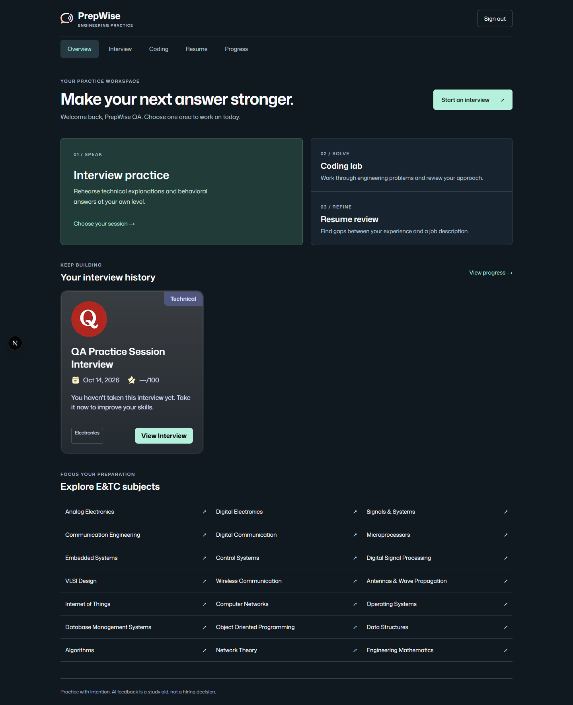
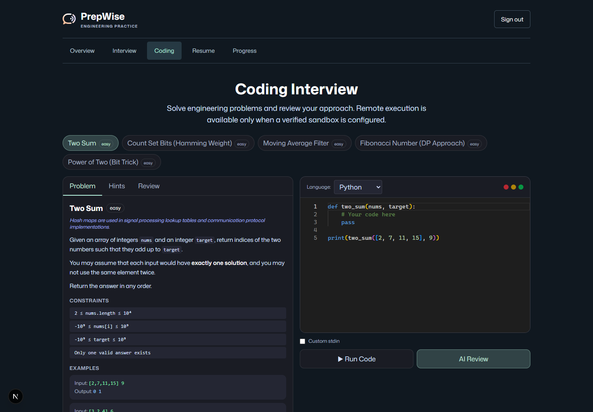
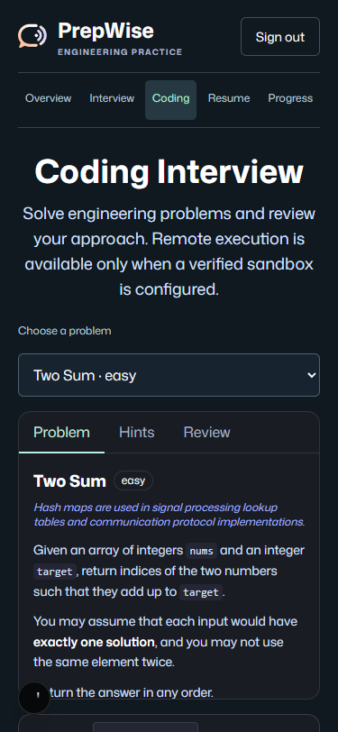
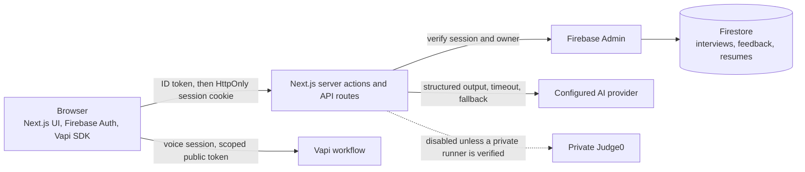

# PrepWise AI Mock Interview

An AI-assisted interview practice app for engineering students, built with Next.js, TypeScript and Firebase. It generates interview questions, runs a voice interview through Vapi, produces schema-validated feedback, and adds resume analysis, PDF reports and a coding practice workspace.

> **Status: local and staging-ready, not production-verified.** Unit tests, type checks and lint pass, but the end-to-end voice, feedback, resume and history journeys have **not** been verified against a staging project. See [Verification status](#verification-status) and [Limitations](#limitations). There is no public deployment.

Default branch: `main`. Based on a public tutorial; see [Attribution and licensing](#attribution-and-licensing).

## Contents

[Overview](#overview) · [Screenshots](#screenshots) · [Architecture](#architecture) · [Stack](#stack) · [Engineering decisions](#engineering-decisions) · [Authentication and data ownership](#authentication-and-data-ownership) · [AI providers and fallback](#ai-providers-and-fallback) · [Verification status](#verification-status) · [Setup](#setup) · [Limitations](#limitations) · [Roadmap](#roadmap) · [Attribution](#attribution)

## Overview

**Problem.** Students preparing for technical interviews, especially in electronics and telecommunication (E&TC) and software roles, rarely get realistic practice with structured feedback.

**What it does.**

- Generates question sets for an interview setup (subject, difficulty, mode) on the server.
- Runs a spoken interview in the browser through a Vapi workflow and captures the transcript.
- Turns the transcript into structured feedback validated against a Zod schema; if analysis fails, the transcript is kept and no scores are invented.
- Parses an uploaded text-based PDF resume (under 5 MiB, at most 20 pages) and analyses it with the configured AI provider.
- Exports feedback as a multi-page PDF report.
- Provides a Monaco-based coding practice workspace with AI review. **Running code is disabled by default** (see [Limitations](#limitations)).

## Screenshots

Captured from the local app during design review; they show the interface, not a live deployment. More sizes and the review notes are in [`docs/qa`](docs/qa/phase2-design-evidence.md).

| Overview (desktop) | Coding practice (desktop) | Coding practice (mobile) |
|---|---|---|
|  |  |  |

## Architecture



Question generation, feedback, resume parsing and history all run on the server and write to Firestore through Firebase Admin. The original resume PDF is not stored in Firebase Storage; only extracted text and analysis are saved. More operational detail is in [DEPLOYMENT.md](DEPLOYMENT.md) and [docs/INTEGRATION_READINESS.md](docs/INTEGRATION_READINESS.md).

## Stack

| Area | Technologies |
|---|---|
| App | Next.js 15 (App Router), React 19, TypeScript, Tailwind CSS 4, Radix UI primitives |
| Data and auth | Firebase Authentication, Cloud Firestore, Firebase Admin |
| AI | Vercel AI SDK with Gemini (default), OpenAI and Anthropic providers |
| Voice | Vapi web SDK |
| Other | Zod validation, Monaco editor, jsPDF, pdf-parse, Recharts |
| Tooling | Node 22, ESLint, `node --test`, Docker / Docker Compose, Vercel config |

## Engineering decisions

- **Server-side everything sensitive.** Privileged work uses server actions and API routes with Firebase Admin; the Firestore rules deny all client writes (`allow write: if false`).
- **Schema-validated AI output.** Provider responses are parsed with Zod; malformed output is rejected rather than shown.
- **Fail honestly.** If feedback analysis fails, the transcript is preserved and a retry action is offered instead of fabricating scores (covered by a test).
- **Fail closed on code execution.** The execute route returns `503` unless `CODE_EXECUTION_ENABLED=true` and a private HTTPS Judge0 endpoint with a key is configured; the public Judge0 host is rejected.
- **Same-origin and rate limits.** Privileged POST routes check origin and apply a per-user rate limiter (in-memory, so per process).
- **Guarded health endpoint.** `/api/health` is read-free; the deep check needs an internal secret because it writes a temporary Storage object.

## Authentication and data ownership

Sign-in uses Firebase email/password. The ID token is exchanged for a Firebase session cookie (`httpOnly`). Every server action and record read compares the stored `userId` with the signed-in user, and `firestore.rules` additionally limits direct client reads to the owner for `interviews`, `feedback`, `resumes`, `jd-matches` and `coding-results`. `storage.rules` allows only a signed-in user to manage PDFs of up to 5 MiB under their own `resumes/{uid}/` path. Owner isolation is covered by tests with mocked data stores, not yet by a staging run.

## AI providers and fallback

Providers are configured in `ai/providers`. `lib/aiFallback.ts` tries the configured providers in `AI_PROVIDER_ORDER`, retrying transient failures (HTTP 408/409/425/429/5xx, quota, timeout) with short backoff, a 20 s per-request timeout, and a 45 s overall deadline. If every provider fails it raises a typed "temporarily unavailable" error that the UI shows. Only Gemini has been exercised live (one synthetic structured-output request); OpenAI and Anthropic paths are implemented but unverified.

## Verification status

| Item | Status | Evidence |
|---|---|---|
| Unit and regression tests | **Passed, rerun 2026-10-16**: 15 of 15 (`npm test`) | Ownership isolation, unauthenticated rejection, failed-analysis integrity, schema rejection, PDF generation, fail-closed executor, health-endpoint secret |
| Type check, lint | **Passed, rerun 2026-10-16** (`npm run typecheck`, `npm run lint`) | |
| Production build | **Not reproduced in the 2026-10-16 audit** | The audit sandbox could not fetch Google Fonts; an earlier record in [`docs/qa/phase4-release-evidence.md`](docs/qa/phase4-release-evidence.md) reports a successful build from a clean copy |
| Dependency audit | Historical (October 2026): zero production vulnerabilities; four dev-only high advisories | [`docs/qa`](docs/qa/phase4-release-evidence.md) |
| Gemini structured output | Historical: one synthetic request succeeded | `npm run test:ai` |
| Firebase Auth, Firestore create/read/delete | Historical: passed in earlier recorded checks | Not rerun |
| Responsive UI | Local screenshots at 375, 390, 768 and 1440 px | `docs/qa` |
| Firebase Storage write/delete, Firestore indexes | **Blocked**: needs an authorized staging project | |
| Vapi voice interview | **Blocked**: needs a configured workflow and microphone test | |
| Full feedback, resume and history journeys | **Unverified end to end** | |
| Code execution | **Intentionally disabled** | |

There is no CI workflow yet; adding one for `npm test`, `typecheck`, `lint` is the first item on the roadmap. Earlier docs quote 11 and 13 passing tests; those are older snapshots and the suite has grown since.

## Setup

Requires Node.js 22+ and, for anything beyond the UI, a Firebase project plus at least one AI provider key.

```bash
git clone https://github.com/Shree1194/prepwise-ai-mock-interview.git
cd prepwise-ai-mock-interview
npm ci
cp .env.example .env.local     # PowerShell: Copy-Item .env.example .env.local
npm run dev                    # http://localhost:3000
```

Fill `.env.local` with Firebase client and Admin values and an AI key (`GOOGLE_GENERATIVE_AI_API_KEY` for the default). `.env.example` contains placeholders only and `.env*` files are git-ignored. Never place Admin or AI keys in `NEXT_PUBLIC_*` variables. A live voice interview additionally needs `NEXT_PUBLIC_VAPI_WEB_TOKEN` and `NEXT_PUBLIC_VAPI_WORKFLOW_ID`. Firebase rules and indexes are deployed with the command in [DEPLOYMENT.md](DEPLOYMENT.md) by a project administrator, to an explicit project.

Local checks:

```bash
npm test && npm run typecheck && npm run lint && npm run build
```

Docker: `npm run docker:up` (see `docker-compose.yml`).

## Limitations

- No staging verification of voice interviews, complete feedback, resume parsing, Storage writes or Firestore indexes. Until these are done, the app should not be described as production-ready.
- **Arbitrary code execution is disabled** and stays so until a private, isolated Judge0 runner is independently verified. The built-in rate limiter is per-process and must be replaced by a shared one first.
- Resume parsing supports text-based PDFs only (no OCR).
- Four dev-only dependency advisories remain via the Next ESLint plugin chain; they are not in the production bundle.
- No CI, no license (see [Attribution and licensing](#attribution-and-licensing)), and no public deployment.
- Some voice-interview and UI structure comes from the tutorial below, so treat those parts as learning material rather than original design.

## Roadmap

1. Add a GitHub Actions workflow for tests, type check and lint.
2. Stand up a staging Firebase project and run the guarded `verify:production` script.
3. Verify the Vapi workflow with a recorded test call and a synthetic resume journey.
4. Provision and verify a private code runner, or keep the feature off.
5. Resolve licensing: ask the tutorial's author about reuse terms, or replace the derived portions.

Issues and pull requests are welcome; please include a regression test with behavior changes.

## Attribution and licensing

This project began as a follow-along build of the **"AI Mock Interview" tutorial by [JavaScript Mastery](https://www.youtube.com/watch?v=8GK8R77Bd7g)**, whose source is published at [adrianhajdin/ai_mock_interviews](https://github.com/adrianhajdin/ai_mock_interviews). The tutorial supplies the starting point: a Next.js and Firebase app with email sign-in, Vapi voice interviews, AI-generated questions and feedback, and the base interface. Those parts are not original to this repository, and this repository does not claim to have built the original application independently.

Extensions in this repository, compared with the tutorial project:

| Area | Additions |
|---|---|
| AI layer | Multi-provider factory (Gemini, OpenAI, Anthropic) with fallback, retries and deadlines; Zod-validated feedback, question and resume schemas |
| Features | E&TC-focused subjects and interview modes, resume parsing and analysis, PDF reports, Monaco coding workspace with AI review, progress analytics |
| Security | Owner-scoped server actions, Firestore and Storage rules, same-origin check, rate limiter, guarded health endpoint, fail-closed code-execution boundary |
| Quality and operations | Regression test suite, QA screenshots and evidence docs, Docker and deployment docs, guarded staging verification script |

**License.** The tutorial repository does not include a license file, so no reuse terms are granted for its code. For that reason this repository has **no `LICENSE` file**, and no open-source license is offered for it. Without a license, others have no permission to copy or reuse the code. A license can be considered once the tutorial's author confirms reuse terms or the derived portions are replaced.

The earlier README's tutorial promotional text and copied style snippets were removed; the link above preserves the credit.
